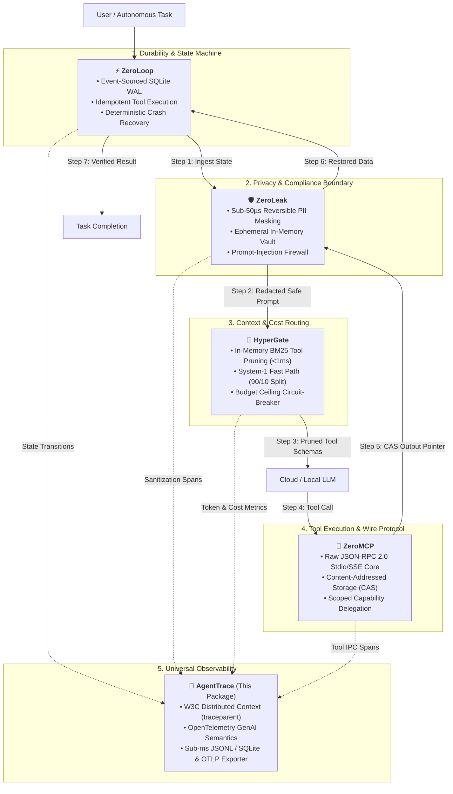

# 🌲 AgentTrace: Zero-Dependency Distributed Tracing for AI Agents & Tool IPC

[](LICENSE)
[-brightgreen.svg)](agenttrace-py/)
[](SPECIFICATION.md)

**AgentTrace** is an ultra-lean, zero-external-dependency distributed tracing and telemetry framework designed specifically for autonomous AI agents, multi-turn task loops, tool execution trees, and Model Context Protocol (MCP) IPC servers.

---

## ⚡ Why AgentTrace?

Existing AI observability tools (LangSmith, Langfuse, Phoenix) are heavy, pull in massive dependency trees (`pydantic`, `requests`, `opentelemetry-sdk`, `grpc`), and focus on individual prompt/completion calls rather than **agent loops, tool IPC framing, and circuit-breaker tripwires**.

AgentTrace solves this with:
1. **Strictly Zero Dependencies**: Pure Python standard library (`json`, `sqlite3`, `time`, `dataclasses`, `uuid`, `urllib.request`).
2. **W3C Distributed Trace Context**: Full `traceparent` support (`00-{trace_id}-{span_id}-01`) for end-to-end correlation across multi-agent systems and MCP tool servers.
3. **OpenTelemetry GenAI Semantic Alignment**: Native OTel attribute mapping (`gen_ai.system`, `gen_ai.request.model`, `tool.transport`).
4. **Local Append-Only JSONL & SQLite Sinks**: Sub-millisecond persistence without sending agent thoughts to third-party clouds.
5. **Pure Python OTLP HTTP/JSON Exporter**: Pipes directly into Jaeger, Grafana Tempo, Honeycomb, or Datadog without heavy SDK bloat.

---

## 🌐 The CreativeUnCommons Agent Architecture Ecosystem

AgentTrace is the universal telemetry and observability engine in the **CreativeUnCommons** agent architecture suite. Each tool in the ecosystem operates under a strict **Zero-Third-Party-Dependency Mandate** (standard library only), **Sub-Millisecond Execution Budgets**, and **Deterministic Correctness**:



### Complete Runtime Synergy

| Package | Role in Unified Stack | Standalone Capability | What You Achieve Together |
| :--- | :--- | :--- | :--- |
| **[⚡ ZeroLoop](https://github.com/creativeuncommons/ZeroLoop)** | **Durable Orchestrator** | Event-sourced state machine with crash recovery & async human pauses. | Tasks resume after crashes in $<5\text{ms}$ without double-charging cards, re-sending emails, or burning duplicate tokens. |
| **[🛡️ ZeroLeak](https://github.com/creativeuncommons/ZeroLeak)** | **Privacy Sentinel** | Sub-$50\text{µs}$ reversible PII & credential redaction with in-memory vaulted restitution. | Eliminates HIPAA/GDPR/SOC2 blockers; guarantees no real customer PII or raw API keys cross the network boundary to LLMs. |
| **[🚪 HyperGate](https://github.com/creativeuncommons/HyperGate)** | **Inference Router & Tool Pruner** | Sub-millisecond BM25 inverted index tool pruner, System-1 classifier, and budget kill-switch. | Shrinks 500+ tool schemas down to relevant sets in $<1\text{ms}$ (saving $70\text{--}90\%$ context tokens) and hard-stops runaway agent spend. |
| **[🔌 ZeroMCP](https://github.com/creativeuncommons/ZeroMCP)** | **Tool Protocol & CAS Engine** | Zero-dependency Model Context Protocol (MCP) runtime (stdio/SSE) with CAS storage. | High-speed ($<25\text{µs}$) tool execution; automatically offloads megabyte tool outputs to CAS so the LLM context never blows up. |
| **[🌲 AgentTrace](https://github.com/creativeuncommons/AgentTrace)** | **Distributed Telemetry & Auditing** *(This Package)* | W3C traceparent context propagation, GenAI semantic conventions, and native OTLP export. | Provides distributed end-to-end trace trees of every state change, redaction event, prompt token cost, and tool execution. |

---

## 📦 Project Structure

```text
AgentTrace/
├── README.md                 # Public open-source README & quickstart
├── SPECIFICATION.md          # W3C trace context & OTel semantic mapping
├── USAGE.md                  # Integration guide, decorators, & OTLP export
├── CHANGELOG.md              # Semantic version history (v0.1.0)
├── LICENSE                   # Apache 2.0 License
├── agenttrace-py/            # Zero-dependency Python SDK (stdlib only)
│   ├── __init__.py
│   ├── agenttrace.py         # Tracer, AgentSpan, TraceStorage, OTLPExporter
│   └── cli.py                # Visual ASCII execution tree renderer
├── agenttrace-rs/            # High-performance native Rust core & CLI
│   ├── Cargo.toml
│   └── src/
│       ├── lib.rs            # Core tracing engine & SQLite/JSONL sinks
│       └── main.rs           # Fast CLI inspection tool
├── tests/                    # Conformance & OTLP serialization tests
│   ├── test_tracer_core.py
│   └── test_otlp_export.py
└── scripts/
    └── promote_to_standalone.py # Standalone export pipeline
```

---

## ⚡ Multi-Language Implementations (Python & Rust)

AgentTrace is provided in both a zero-dependency Python standard library edition and a high-performance native Rust core:

| Implementation | Location | Dependencies | Latency (p50) | Throughput | Use Case |
| :--- | :--- | :--- | :---: | :---: | :--- |
| **`agenttrace-py`** | `agenttrace-py/agenttrace.py` | Pure Python stdlib (0 deps) | $0.71\text{ µs}$ parse | $\sim 1,410,000\text{ ops/sec}$ | Python agent orchestrators, LangChain/LlamaIndex hooks, zero-install |
| **`agenttrace-rs`** | `agenttrace-rs/` | Rust stdlib + rusqlite, serde, uuid | $< 0.20\text{ µs}$ parse | $\sim 5,000,000+\text{ ops/sec}$ | High-concurrency edge agents, native IPC proxies, microsecond tracing |

### Building and Running the Rust Core
```bash
# Build release binary
cd agenttrace-rs && cargo build --release

# Record a test demo trace
./target/release/agenttrace --demo

# Inspect trace spans by Trace ID
./target/release/agenttrace --trace <TRACE_ID>
```

---

## 🚀 Quick Example

```python
from agenttrace import get_tracer, SpanKind

tracer = get_tracer(service_name="analyst-agent")

with tracer.span("agent.loop", kind=SpanKind.AGENT) as root:
    root.set_attribute("agent.goal", "Process financial filings")

    with tracer.span("tool.mcp_query", kind=SpanKind.TOOL) as tool:
        tool.set_attribute("tool.name", "fetch_sec_filing")
        tool.set_attribute("tool.transport", "zeromcp_stdio")
        tool.add_event("filing.parsed", {"ticker": "AAPL", "pages": 84})
```

### Render Execution Tree via CLI

```bash
python3 -m agenttrace --tree <trace_id>
```

```text
🌲 AgentTrace Execution Tree: c1a8e932b10a44f798e24c2918fa2201
================================================================================
└── ✅ [AGENT] agent.loop (14.20 ms)
    ├── 🏷️ agent.goal: Process financial filings
    └── ✅ [TOOL] tool.mcp_query (8.40 ms)
        ├── 🏷️ tool.name: fetch_sec_filing
        ├── 🏷️ tool.transport: zeromcp_stdio
        └── ⚡ Event: filing.parsed
================================================================================
```

### Golden-Path CI Trajectory Grader

Assert agent trajectory conformance in CI pipelines:
```bash
python3 scripts/agenttrace-check --actual actual.json --golden golden.json --max-dist 0
```

---

## 📄 License

Distributed under the [Apache License 2.0](LICENSE).
